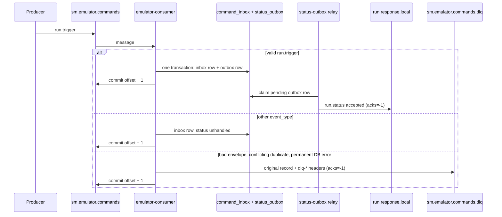

# Emulator consumer: events and payloads

This is the event and payload reference. For the short overview (layout, how to run, tests) see
[README.md](./README.md).

## 1. What this process is

The emulator consumer is a separate Nest process (`worker-main.ts`, which starts `EmulatorConsumerModule`).
It is not part of the API and is not registered on `AppModule`. It reads the trigger topic, stores each
command in Postgres, and for a `run.trigger` it also writes a `run.status` row for later publishing. It
does not run an emulation. "Accepted" means the command was stored and the Kafka offset can be committed.

## 2. How an event is consumed

Settings:

| Setting | Value |
|---|---|
| Topic | `EMULATOR_CONSUMER_TOPIC`, default `sm.emulator.commands` |
| Consumer group | `EMULATOR_CONSUMER_GROUP_ID` (required; local: `emulator-consumer-local`) |
| Start position | `fromBeginning: true` |
| Commit mode | `autoCommit: false` |
| Concurrency | `partitionsConsumedConcurrently: 1`, so one message at a time per partition |

One message, from Kafka to the offset commit:

1. KafkaJS calls `eachMessage` in `startConsumer`. It passes the topic, partition, offset, key, value and headers to `processMessage`.
2. `processMessage` calls `parseEnvelope` on the raw value. If it throws an `EnvelopeError`, the message is copied to the DLQ and `processMessage` returns.
3. Otherwise `handleEnvelope` runs inside `withRetry`. It writes `command_inbox` (and, for a trigger, `status_outbox`) in one Postgres transaction.
4. `processMessage` returns. Only then does `startConsumer` call `commitOffsets` with `offset + 1`.

If `processMessage` throws, nothing is committed.

The idempotency key is `UNIQUE (correlation_id, event_type, sequence)` on `command_inbox`. The insert uses
`ON CONFLICT ... DO NOTHING`, so redelivery is always safe.

Outcomes:

| Outcome | When | What is written | Offset |
|---|---|---|---|
| `accepted` | Valid `run.trigger`, key not seen before | `command_inbox` row with status `accepted` and a `status_outbox` row, in one transaction | Committed |
| `duplicate` | Same key and same bytes (same `payload_hash`) | Nothing | Committed |
| `conflicting_duplicate` | Same key, different bytes | Nothing in the database. The stored row is untouched. The message is copied to the DLQ | Committed after the DLQ publish |
| `unhandled` | Valid envelope with any other `event_type` | `command_inbox` row with status `unhandled`, and a warning log. No outbox row | Committed |
| DLQ (bad envelope) | Empty value, bad UTF-8, bad JSON, not an object, or a bad envelope field | Nothing in the database. The message is copied to the DLQ | Committed after the DLQ publish |
| `permanent_db_error` | Postgres error class 22 (for example `\u0000` in the JSON, value too long), 23 (constraint) or 54 (row too large) | Nothing. The message is copied to the DLQ | Committed after the DLQ publish |
| Transient retry | Any other database error (connection, timeout, deadlock, unknown), or the DLQ publish itself fails | Nothing | Retried with backoff. If it keeps failing, nothing is committed, KafkaJS restarts the consumer and the message comes again |

Retry settings: `EMULATOR_CONSUMER_RETRY_ATTEMPTS` (default 5), `EMULATOR_CONSUMER_RETRY_BASE_DELAY_MS`
(default 500) and `EMULATOR_CONSUMER_RETRY_MAX_DELAY_MS` (default 5000).

## 3. Inbound payload (what is consumed)

The consumer reads only the envelope.

| Field | Rule | Stored as |
|---|---|---|
| `event_type` | Required non-empty string (trimmed) | `command_inbox.event_type` |
| `correlation_id` | Required non-empty string (trimmed) | `command_inbox.correlation_id` |
| `engine` | Required non-empty string (trimmed) | `command_inbox.engine` |
| `version` | Optional string | `command_inbox.version` |
| `issued_at` | Optional string. Not parsed as a date | `command_inbox.issued_at` |
| `sequence` | Optional positive integer. Stored as `0` when absent | `command_inbox.sequence` |

Also stored:

- `payload_hash` is the SHA-256 hex of the raw Kafka bytes.
- The whole parsed JSON object goes into `command_inbox.body`, unchanged.

Everything else in the message is opaque. The consumer has no models for `references`, `data`, `config` or
`run`, and it never branches on `version`.

### Event types

The README lists four command types: `run.trigger`, `run.pause`, `run.resume` and `run.cancel`. In the
code, only `run.trigger` is treated specially (`RUN_TRIGGER` in `handler.ts`). It is stored with status
`accepted` and gets a status row. `run.pause`, `run.resume`, `run.cancel`, and any other `event_type`, are
stored with status `unhandled` and produce no response.

Answering the non-trigger commands with `decision=rejected` is not built.

### Example: the agreed `run.trigger` (v1.1)

This is the agreed example that Scenario Manager sends (`triggerV11` in `test-support/fixtures.ts`). It is
not a schema the consumer validates. The consumer checks only the envelope fields.

```json
{
  "event_type": "run.trigger",
  "command_id": "run",
  "version": "1.1",
  "engine": "emulator",
  "sequence": 1,
  "correlation_id": "cid_0001",
  "issued_at": "2026-10-29T10:00:00Z",
  "issued_by": "user@example.com",
  "priority": "normal",
  "references": {
    "project_id": "proj-1",
    "scenario_id": "11111111-1111-4111-8111-111111111111",
    "map_id": "22222222-2222-4222-8222-222222222222",
    "map_version_id": "mv-3",
    "pins": [{ "service": "foundry", "artifact_type": "map", "id": "map-1", "version": "3" }]
  },
  "data": {
    "inbound": {
      "uri": "gs://bucket/inbound.csv",
      "sha256": "aaaaaaaaaaaaaaaaaaaaaaaaaaaaaaaaaaaaaaaaaaaaaaaaaaaaaaaaaaaaaaaa",
      "size_bytes": 10,
      "rows": 2
    }
  },
  "config": {
    "agent": { "count": 5 },
    "station": {
      "count": 2,
      "pps": [
        { "pps_id": "PPS-101", "mode": "pick", "flow": "automatic" },
        { "pps_id": "PPS-102", "mode": "put", "flow": "automatic" }
      ]
    },
    "wms_order": { "lines": 10 }
  },
  "run": { "execution_duration_minutes": 60, "stop_policy": "hard_stop" }
}
```

`config.station.pps[]` has one row per PPS with `pps_id`, `mode` (`pick` or `put`) and `flow`. At least one PPS must be `put`. The consumer does not check this; the emulator does.

### Example: minimal accepted message

Only the three required fields. It is accepted as a `run.trigger`, stored with `sequence` 0.

```json
{
  "event_type": "run.trigger",
  "correlation_id": "cid_min",
  "engine": "emulator"
}
```

### Envelope errors (sent to the DLQ)

| Reason | Cause |
|---|---|
| `empty_value` | The Kafka value is null or has zero bytes |
| `invalid_utf8` | The bytes are not valid UTF-8 |
| `invalid_json` | The text is not valid JSON |
| `not_an_object` | The JSON is not an object (an array, string, number or `null`) |
| `invalid_event_type` | `event_type` is missing, not a string, or blank |
| `invalid_correlation_id` | `correlation_id` is missing, not a string, or blank |
| `invalid_engine` | `engine` is missing, not a string, or blank |
| `invalid_version` | `version` is present but not a string |
| `invalid_issued_at` | `issued_at` is present but not a string |
| `invalid_sequence` | `sequence` is present but not a positive safe integer |

`sequence` is checked first, then `event_type`, `correlation_id` and `engine`, then `version` and `issued_at`.
A message with several problems is reported with the first reason it hits.

## 4. How a status is published

The consumer does not call Kafka to publish `run.status`. For a valid `run.trigger` it inserts the
`command_inbox` row and the `status_outbox` row in the same transaction. That insert is the publish: a
rollback leaves no row, a commit makes the message durable.

A separate process, the status-outbox relay, later sends the stored topic, key and payload with `acks=-1`.
See [src/status-outbox/README.md](../status-outbox/README.md).

- Response topic: `EMULATOR_CONSUMER_RESPONSE_TOPIC` (required; local: `run.response.local`).
- Message key: `correlation_id`.

These cases get no outbox row:

- duplicates
- conflicting duplicates
- unhandled event types
- DLQ copies

## 5. Outbound payload (what is published)

This is the exact object built in `handler.ts`.

Always present:

| Field | Value |
|---|---|
| `event_type` | `"run.status"` |
| `correlation_id` | The trigger's `correlation_id` |
| `engine` | The trigger's `engine` |
| `status` | `"accepted"` |
| `sequence` | `1` |
| `emitted_at` | The time of the transaction, as an ISO string |

Present only when the trigger's `sequence` is greater than 0:

| Field | Value |
|---|---|
| `command_id` | `"run"` |
| `command_sequence` | The trigger's `sequence` |
| `decision` | `"accepted"` |

`sequence` here is always `1`. It is the first status of this execution, not the command's sequence. The
command's sequence is `command_sequence`. A trigger with no `sequence` has nothing to echo, so those three
fields are left out.

The row is written once, so a resend after a relay crash carries the identical payload.

Trigger with `sequence` 1:

```json
{
  "event_type": "run.status",
  "correlation_id": "cid_0001",
  "engine": "emulator",
  "status": "accepted",
  "sequence": 1,
  "emitted_at": "2026-10-29T10:00:01.123Z",
  "command_id": "run",
  "command_sequence": 1,
  "decision": "accepted"
}
```

Trigger with no `sequence`:

```json
{
  "event_type": "run.status",
  "correlation_id": "cid_min",
  "engine": "emulator",
  "status": "accepted",
  "sequence": 1,
  "emitted_at": "2026-10-29T10:00:01.123Z"
}
```

## 6. Dead-letter payload

The DLQ topic is `EMULATOR_CONSUMER_DLQ_TOPIC` (required; local: `sm.emulator.commands.dlq`).

The record keeps the original key, value and headers, byte for byte. These headers are added:

| Header | Value |
|---|---|
| `dlq-reason` | The reason code |
| `dlq-detail` | Detail text (an empty string when there is none) |
| `dlq-source-topic` | The topic the message came from |
| `dlq-source-partition` | The partition, as a string |
| `dlq-source-offset` | The offset, as a string |

The publish uses `acks=-1`, and the offset is committed only after the broker has acknowledged it.

Reasons:

- The ten envelope reasons from section 3: `empty_value`, `invalid_utf8`, `invalid_json`, `not_an_object`, `invalid_event_type`, `invalid_correlation_id`, `invalid_engine`, `invalid_version`, `invalid_issued_at`, `invalid_sequence`.
- `conflicting_duplicate`: same `correlation_id`, `event_type` and `sequence` with a different payload.
- `permanent_db_error`: the detail is the Postgres error code and message.

## 7. Flow


