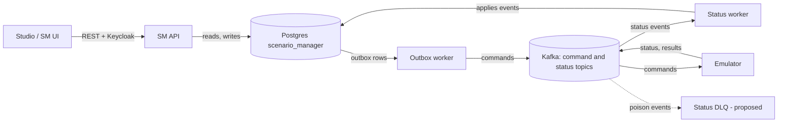
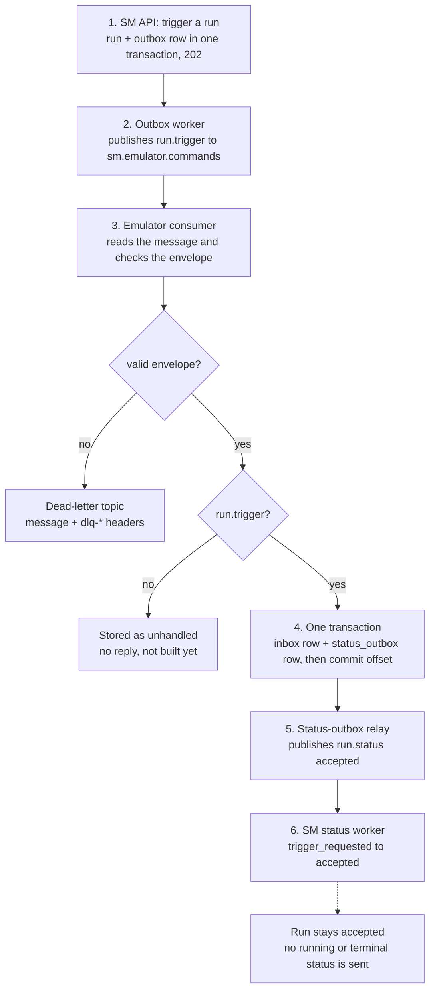
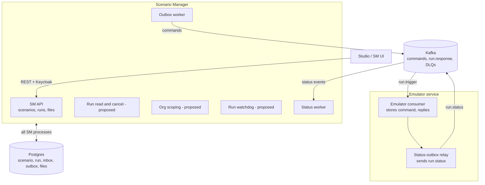

# Scenario Manager architecture review

2026-11-17

Scenario Manager should stay a thin control plane; the work left is read-side APIs, access control and failure recovery, not a new execution engine.

## Verdict

Keep Scenario Manager (SM) as a control plane, which is what the code already is: it owns scenarios, run records and status, and engines own execution. No code supports the orchestrator approach, since SM has no executor.

The write side is complete (trigger, outbox, status worker). The read side and recovery are not: a user can start a run but cannot see it, cancel it, or recover if the engine goes quiet. Fix those first, and leave live view (option A, the simulator hosting the socket) until DeSSim resumes.

Scope: read-only review of `apps/scenario-manager`, with the emulator as the only engine for now. DeSSim (the simulator) is on hold and not assessed. Studio is not referenced in SM code, so that integration is not assessed either.

## What SM is today

SM is a NestJS and Postgres service that runs as three processes and contains no simulation code.

| Process | Job | Verified guarantees |
| --- | --- | --- |
| API (`/api/v1`) | Scenarios (create, clone, edit, delete), data-file upload through signed GCS URLs, maps and projects read through a Foundry client, `POST /scenarios/:id/runs` | Idempotency-Key with request hash; one active run per scenario (unique index) |
| Outbox worker | Reads `run_outbox` and publishes commands to Kafka | At-least-once, leases, backoff; the run row and the Kafka event commit in one transaction |
| Status worker | Consumes engine events and updates `run` and `scenario` | Per-run sequence, receipt ledger, events after a gap are held, offset commit only after the transaction |

A trigger validates the scenario, pins upstream versions, snapshots the config, then writes the run and the full `run.trigger` event together. A 202 means durably queued, not accepted by the engine. Run states: `trigger_requested`, `accepted`, `setup_ready`, `running`, `paused`, then a terminal state (`completed`, `failed`, `cancelled`, `interrupted`).

The emulator consumer under `src/emulator-consumer/` is untracked and holds only a doc. It stands in for an engine: it stores a command and replies "accepted", and runs no emulation.

## Problems to fix first

Eight verified problems, ordered by how badly they hurt; the first four block production use.

| # | Problem | Evidence in code | Effect |
| --- | --- | --- | --- |
| 1 | Upstream check is a mock | `runs.module.ts` always provides `MockRunUpstream`, with no environment switch (`maps` and `projects` have one) | Every map exists and is pinned as `v1` |
| 2 | A stuck run cannot be unstuck | Silence never fails a run; no cancel route; unique index `run_one_active_per_scenario` | A scenario whose engine never answers is blocked for good |
| 3 | No run read API, no commands | Only run route is `POST /scenarios/:id/runs`; its `Location` header points at `/v1/runs/{id}`, which does not exist | A UI cannot show progress; pause, resume and cancel are unreachable |
| 4 | No authorization | Keycloak checks identity only; scenario queries have no org or owner filter | Any signed-in user with a scenario id can read, edit, delete or trigger it |
| 5 | Bad status event blocks its partition | Status worker re-throws and never commits; the review doc says "no DLQ" | One malformed event stops everything behind it |
| 6 | Missing events never repaired | Gaps are held; retrieval API still "requires agreement" | A lost event stalls that run |
| 7 | Schema defined in three places, no migrations | `schema.sql`, the Drizzle schema and a "must match" comment; `SM_FOR_SCHEMA_RESET_ON_START` can wipe data | Any schema change means a fresh database |
| 8 | Smaller debt | 294-line trigger use case; long "OBSERVABILITY PLAN" comments; emulator-consumer doc links to missing files | Harder to read and review |

## Orchestrator or control plane

Choose the control plane: it is what the code already does, and nothing in SM supports the orchestrator approach.

| | 1. SM orchestrates execution | 2. SM is a control plane (recommended) |
| --- | --- | --- |
| SM owns | Scenarios, runs and the engine lifecycle (provisioning, scheduling, cancel) | Scenario and run records, status and lifecycle; engines own execution |
| Complexity | High: duplicates what the emulator already does | Low to medium: mostly built |
| Scalability | SM scales with simulation load | SM scales with event volume; engines scale on their own |
| Operations | You run a compute platform | An API, a database and two small workers |
| Maintenance | Drifts from the engines | One versioned event contract |
| Effect on other services | Moves work out of the engines | Matches what they already assume: Kafka commands and status |
| Integration | Tight: SM embeds the engine | Loose: a contract |

A better variant is the control plane plus an explicit engine contract: one versioned event schema shared by the emulator and, later, DeSSim, and a heartbeat-and-timeout policy. SM never mirrors engine internals.

## Live view: where the socket lives

Pick option A, the simulator hosts the socket, for v1. It follows the draft SM WebSocket Topology proposal, whose three options differ in who dials whom and who owns the server.

On hold: this depends on the simulator (DeSSim), which is paused. The comparison stays for when it resumes.

| | A. Simulator hosts (recommended) | B. Shared WS cluster | C. SM hosts |
| --- | --- | --- | --- |
| How it works | SM client connects to the simulator's existing daphne service | A third service; the simulator publishes, SM subscribes | SM builds the server; the simulator connects out and publishes |
| New services | None | A new service plus a publishing path, with a new owner | None on the simulator side |
| Replay after reconnect | Local read of `Event_data` | Cluster calls back or keeps its own copy | SM calls the simulator's pull API |
| Auth | Simulator enforces; SM sends a ticket or token | Cluster enforces; needs run ownership data | SM enforces for its own users |
| Failure the simulator team owns | Its daphne and Redis | The cluster plus its publisher | Outbound sockets and reconnects |
| Cost of switching later | Low if the frame format is fixed | Low | Low |

Two cautions. First, the socket is display only: the simulator's `state` frames and SM's `run.status` can disagree, so the UI takes run status from the SM API. Second, option B becomes the answer only if a shared cluster already exists or the Emulator team needs the same streaming; the proposal says that changes the work list. Load is unmeasured, and the repo pins `daphne==2.5.0`, which may need an upgrade.

## Roadmap

Phase 1 closes the four production blockers; phases 2 and 3 add recovery and live view. Priority runs P0 (first) to P3.

| Phase | Task | Priority | Complexity | Benefit |
| --- | --- | --- | --- | --- |
| 1. Immediate | Replace `MockRunUpstream` with the real Foundry call, switched on `env` like `maps` | P0 | Low | Real version pins |
| 1. Immediate | Add `GET /runs/:correlation_id` and a latest-run summary on scenario responses | P0 | Low | UI can show progress |
| 1. Immediate | Add cancel using the existing outbox command path | P0 | Medium | Unblocks stuck scenarios |
| 1. Immediate | Org and ownership scoping on every scenario query | P0 | Medium | Closes the access gap |
| 1. Immediate | Fix the dead `Location` header and doc links | P2 | Low | Honest API |
| 2. Architecture | Status-worker DLQ, matching the emulator consumer's | P1 | Medium | One bad event no longer stops a partition |
| 2. Architecture | Run watchdog for runs stuck before `running` | P1 | Medium | No permanent deadlock |
| 2. Architecture | Heartbeat staleness policy: alert first, fail later | P1 | Medium | Detects dead engines |
| 2. Architecture | Migrations before the first production data | P1 | Medium | Safe schema change |
| 2. Architecture | Move the emulator consumer under `tools/` or its own app | P2 | Low | Clean boundary |
| 2. Architecture | Split the trigger use case: orchestration vs telemetry | P3 | Low | Easier to read |
| 3. Long term | Sequence-gap repair against an engine retrieval API | P2 | Medium | No manual recovery |
| 3. Long term | Live activity over WebSocket, option A (on hold with DeSSim) | P2 | Medium | Live view without a new service |
| 3. Long term | Load test the status worker and the WebSocket path | P2 | Medium | Capacity numbers |

## Target architecture

SM owns the scenario, run, event-receipt, outbox and file tables plus the run-status API; engines own execution, activity events and their own event log. Kafka carries commands and status only. The dashed box is proposed, as are the run watchdog (fails runs stuck before `running`), cancel and the run read API; the rest exists today.

## Emulator run flow

This is the flow with the emulator as the only engine, taken from the emulator consumer doc and the SM trigger code. A bad envelope, a conflicting duplicate or a permanent database error goes to the dead-letter topic and the offset is committed after the publish. Pause, resume and cancel are stored as unhandled and get no reply. The consumer sends one `accepted` status and runs no emulation, so a run never reaches `running` or a terminal state; that is problem 2 in practice, and the run watchdog and cancel are what free the scenario.

## Proposed architecture

Three processes stay: the API, the outbox worker and the status worker. The changes are additions inside SM: a run read and cancel API, org and owner scoping on every scenario query, and a run watchdog that fails runs stuck before `running`. The emulator side is the consumer and its status-outbox relay; SM talks to it only through Kafka, so DeSSim can be added later as a second consumer on its own topic without changing SM.

## Related documents

- [Scenario Manager architecture review](https://claude.ai/artifact/77v1AHKVsS1dob6GaK3Grs): the Claude Doc version of this file.
- [SM WebSocket Topology](https://claude.ai/artifact/QeveYFyyAg9ByVP6C5psqF): draft proposal with options A, B and C for where the live-run socket lives.
- [Emulator runtime event generator and WebSocket layer](https://claude.ai/artifact/2g9AXBbe1jwKn333bn4dsP): design for the emulator event generator, command handling and live WebSocket layer.
