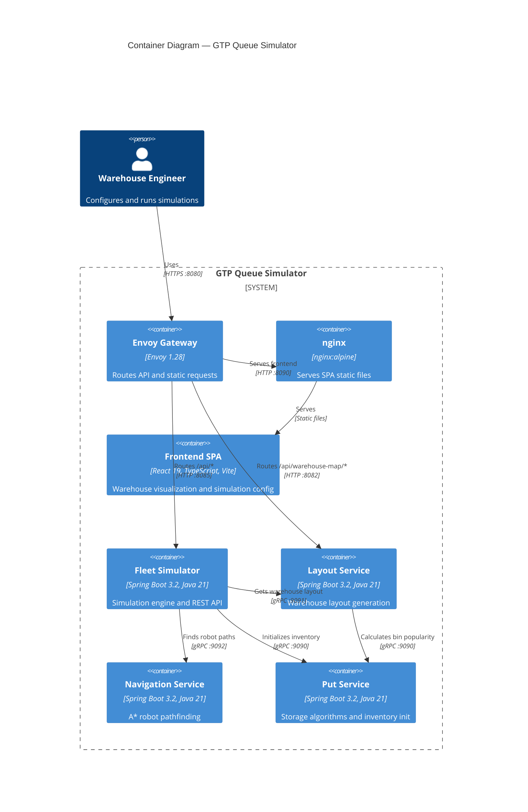

# Container Diagram — GTP Queue Simulator

> Mermaid (renders on GitHub). For Structurizr, use [`workspace.dsl`](workspace.dsl).

All services, protocols, and ports.

**Protocol boundaries:**
- **External → Envoy**: HTTPS (Cloud Run terminates TLS)
- **Envoy → backends**: HTTP (localhost network in Cloud Run)
- **Service-to-service**: gRPC (localhost network)

**Routing rules** (Envoy):
| Pattern | Target | Timeout |
|---------|--------|---------|
| `/api/warehouse-map/*` | layout-service :8082 | 30s |
| `/api/*` | fleet-simulator :8085 | 300s |
| `/`, `/assets/*` | nginx :8090 | 30s |
