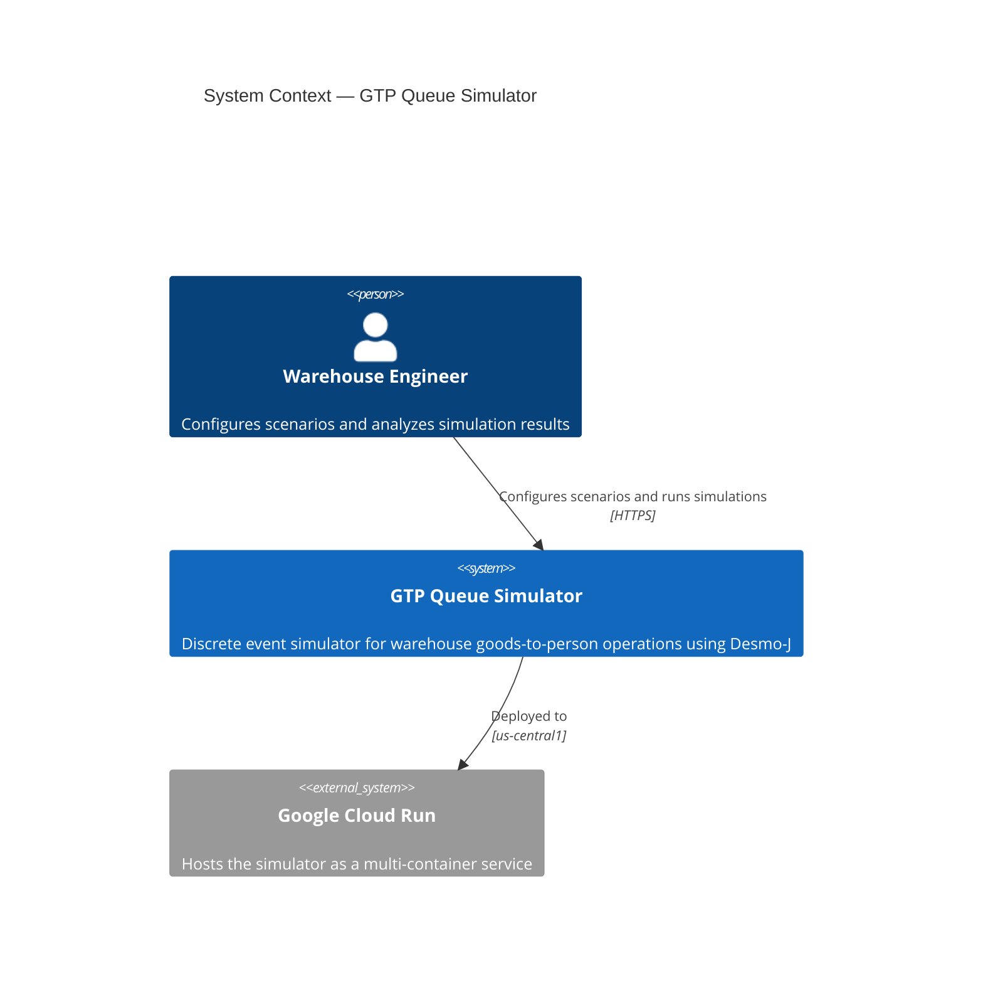

# System Context — GTP Queue Simulator

> Mermaid (renders on GitHub). For Structurizr, use [`workspace.dsl`](workspace.dsl).

Who uses it, what it is, where it runs.

**Notes:**
- Single user type — warehouse engineers who design and tune GTP layouts
- No external system integrations (self-contained simulator)
- Cloud Run provides serverless hosting with concurrency=1 (one simulation at a time)
