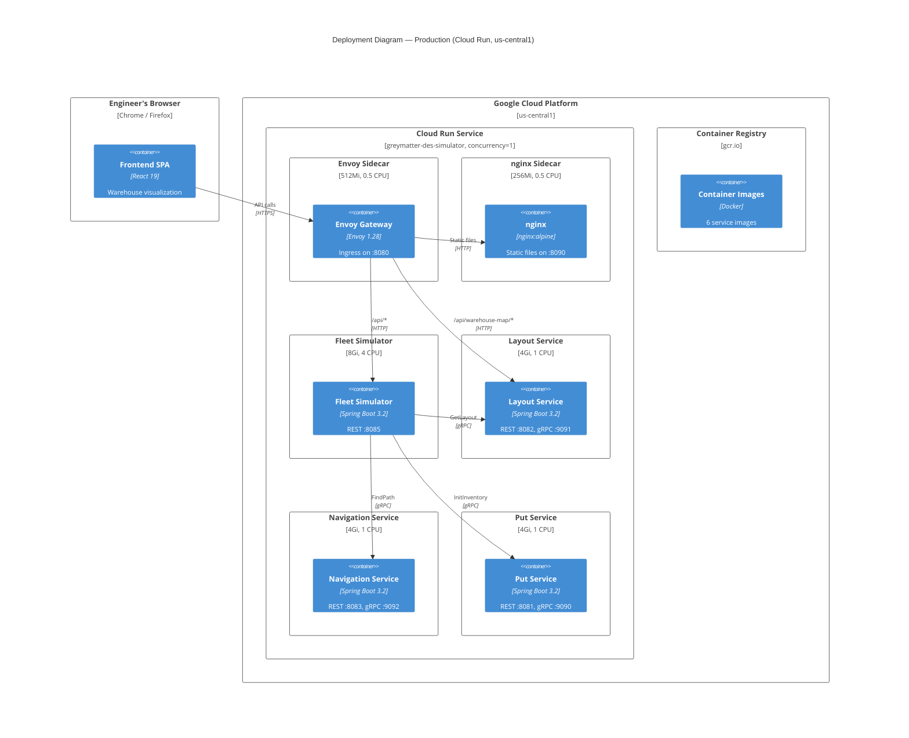

# Deployment Diagram — Production (Cloud Run)

> Mermaid (renders on GitHub). For Structurizr, use [`workspace.dsl`](workspace.dsl).

Multi-container topology on Google Cloud Run.

**Key details:**
- All 6 containers run as sidecars in a **single Cloud Run revision** sharing localhost network
- **Concurrency = 1** — one simulation at a time per instance
- **Min/max instances = 1** — always-warm, no scale-out (simulations are CPU-bound)
- **Request timeout = 3600s** (1 hour max for long simulations)
- **Total resources: 24Gi memory, 8 CPU**
- Envoy starts last (depends on all backends being healthy)
