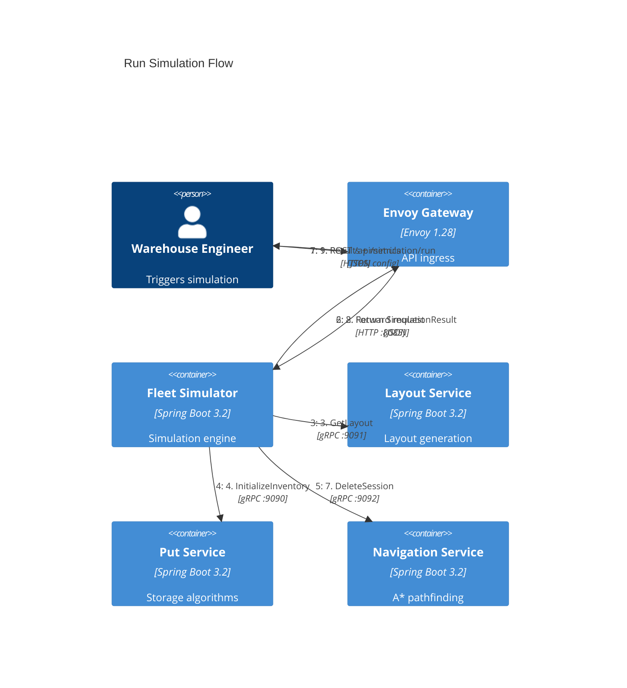

# Dynamic Diagram — Run Simulation

> Mermaid (renders on GitHub). For Structurizr, use [`workspace.dsl`](workspace.dsl).

The core workflow: user submits a config, system runs a discrete event simulation, returns results.

**Step details:**

| Step | What happens |
|------|-------------|
| 1-2 | JSON config includes warehouse dimensions, robot count, order profiles, algorithm selection |
| 3 | Fleet Simulator gets the physical warehouse layout (rack positions, aisles, operator stations) |
| 4 | Put Service initializes bin inventory using the selected put algorithm (greedy, ABC classification) |
| 5 | Navigation Service creates a pathfinding session with the warehouse grid for collision-aware routing |
| 5→6 | *Internally*, Desmo-J runs the discrete event loop — robots pick orders, travel paths, queue at operators |
| 6 | Each robot movement triggers an A* pathfinding call (most frequent gRPC call during simulation) |
| 7 | Session cleanup frees navigation service memory |
| 8-9 | Results include throughput metrics, queue depths, robot utilization, operator idle time |
