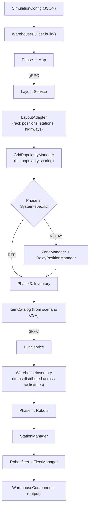
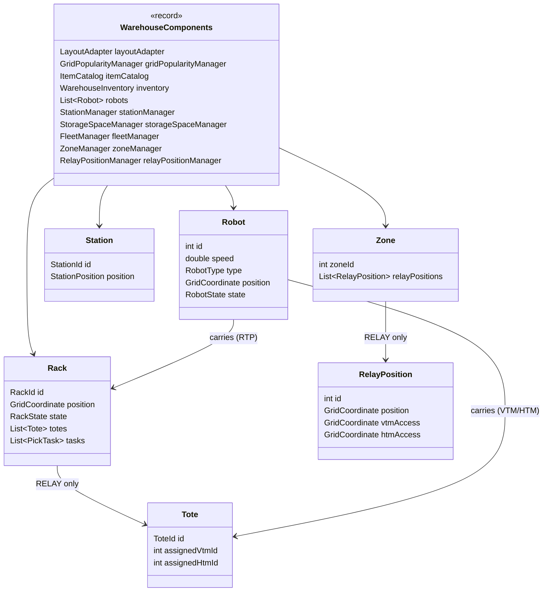

# Fleet Simulator — Domain Model & Warehouse Building

How JSON config becomes a fully initialized warehouse ready for simulation.

## WarehouseBuilder Pipeline

Single-use builder. 4 phases, sequential, with validation gates between each.



## Config → Domain Mapping

```json
{
  "systemType": "RTP | RELAY",
  "simulationDurationMinutes": 60,
  "mapConfig": { "→LayoutConfigDTO → layout-service gRPC" },
  "robotConfig": { "→ RtpRobotConfig | RelayRobotConfig" },
  "operatorConfig": { "→ timePerPick, targetPicksPerFace, numBins" },
  "algorithmConfig": { "→ putAlgorithm, orderSelectionAlgorithm" }
}
```

| Config Section | Domain Object | Source |
|---------------|---------------|--------|
| `mapConfig` | `LayoutAdapter` | layout-service (gRPC) |
| `mapConfig` | `GridPopularityManager` | Computed from layout |
| `mapConfig.stationLayout` | `StationManager`, `Station[]` | layout-service |
| `robotConfig` | `Robot[]`, `FleetManager` | Built locally |
| `algorithmConfig.putAlgorithm` | `WarehouseInventory` | put-service (gRPC) |
| Scenario CSV | `ItemCatalog` | File I/O |

## Domain Object Hierarchy



## RTP vs RELAY — What Gets Built

| Component | RTP | RELAY |
|-----------|-----|-------|
| Racks | From layout positions | From layout positions |
| Totes | None | `verticalCapacity × numRacks` per rack |
| Zones | None | Generated from rack block gaps |
| Relay positions | None | From layout, linked to zones |
| Robots | N × RTP | N × VTM + M × HTM |
| Inventory target | Racks | Totes |
| BackToStoreSelector | `RtpBackToStoreSelector` | `RelayBackToStoreSelector` |

## Phase Details

### Phase 1: Map

Calls layout-service gRPC `GetLayout(LayoutRequest)`. Falls back to mock layout when `layoutServiceClient == null` (test mode).

**LayoutAdapter** wraps the proto response, providing:
- Rack positions (grid coordinates)
- Station positions (with access directions)
- Relay positions (VTM/HTM access points)
- Highways (pathfinding corridors)
- Rack block structure (rows, columns, gaps)

### Phase 2: System-Specific (RELAY only)

**ZoneManager** — maps physical aisles to logical zones. Each zone = gap between two rack blocks.

**RelayPositionManager** — two-phase initialization:
1. Metadata (here): position coordinates, access points
2. Runtime (in `DesmojSimulationEngine`): Desmo-J `Res` resources for capacity management

Validates shuttle config: must have >= 1 VTM per aisle.

### Phase 3: Inventory

1. Creates `Rack` objects from layout positions
2. Creates `Tote` objects nested in racks (RELAY only)
3. Loads `ItemCatalog` from scenario CSV (`sku, name, category, weight, qty, popularity`)
4. Calls put-service gRPC `InitializeInventory` — distributes items across storage spaces
5. Creates `StorageSpaceManager` for unified rack/tote access

### Phase 4: Robots

Creates robot fleet from config:
- **RTP**: `numRobots` robots at origin (0,0)
- **RELAY**: `numVtms` VTMs + `numHtms` HTMs, sequential IDs

All robots start at origin. VTMs get repositioned to zone centers during `DesmojSimulationEngine.run()`.

## Key Files

| Class | Path (relative to `fleet-simulator/src/main/java/.../`) |
|-------|------|
| `Simulator` | `simulator/Simulator.java` |
| `WarehouseBuilder` | `simulator/WarehouseBuilder.java` |
| `WarehouseComponents` | `simulator/metrics/SimulationMetrics.java` |
| `SimulationConfig` | `simulator/config/SimulationConfigs.java` |
| `LayoutAdapter` | `adapter/LayoutAdapter.java` |
| `Robot` | `domain/robot/Robot.java` |
| `Rack` | `domain/inventory/Rack.java` |
| `Tote` | `domain/inventory/Tote.java` |
| `Station` | `domain/station/Station.java` |
| `ZoneManager` | `domain/robot/ZoneManager.java` |
| `RelayPositionManager` | `domain/robot/RelayPositionManager.java` |
| `ItemCatalog` | `domain/inventory/ItemCatalog.java` |
| `WarehouseInventory` | `domain/inventory/WarehouseInventory.java` |
| `StorageSpaceManager` | `domain/inventory/StorageSpaceManager.java` |
| `GridPopularityManager` | `domain/put/GridPopularityManager.java` |
