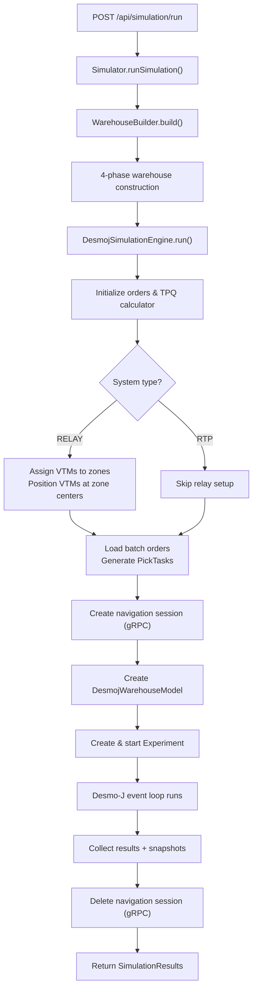
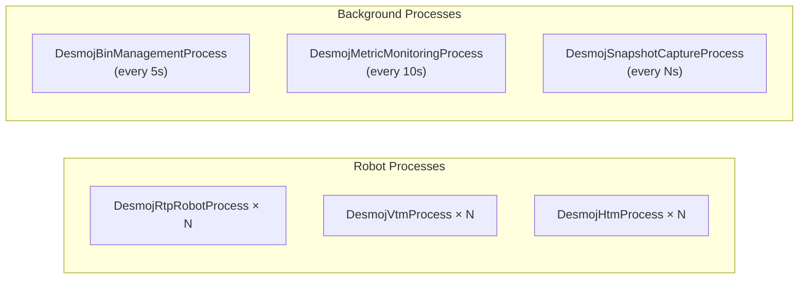
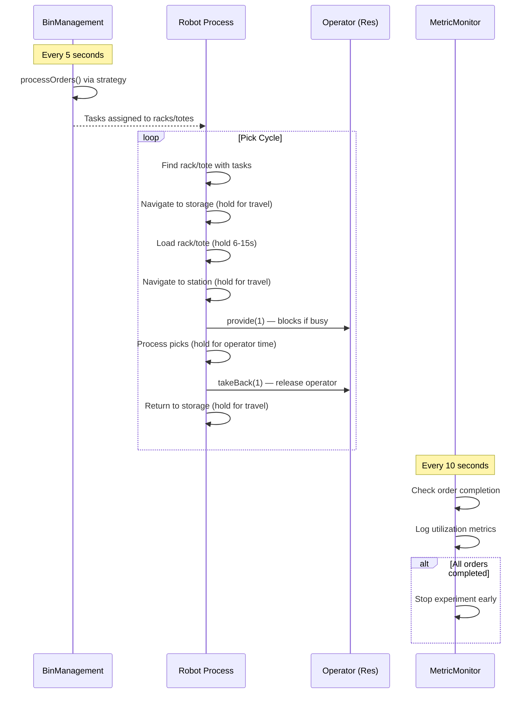

# Fleet Simulator — Simulation Engine

How the discrete event simulation runs, from REST request to results.

## Execution Stack

```
REST API (SimulationController)
  → Simulator.runSimulation()
    → WarehouseBuilder.build()           → WarehouseComponents
    → DesmojSimulationEngine.run()       → SimulationResults
      → DesmojWarehouseModel (Desmo-J Model)
        → SimProcess instances (robots, bin mgmt, metrics, snapshots)
```

## Simulation Lifecycle



## Desmo-J Integration

The simulator uses [Desmo-J](http://desmoj.sourceforge.net/) — a Java discrete event simulation framework.

### Key Concepts

| Desmo-J | Our Usage |
|---------|-----------|
| `Model` | `DesmojWarehouseModel` — owns operator resources, provides `findPath()` |
| `Experiment` | Created per simulation run, controls duration and clock |
| `SimProcess` | One per robot + background processes (bin mgmt, metrics, snapshots) |
| `Res` | Operator resources (capacity=1 per station), relay position slots |
| `hold()` | Suspends a process for simulated time (travel, loading, operator work) |
| `TimeSpan` | Duration in simulation time units (seconds) |

### Threading Model

Desmo-J is **single-threaded** (cooperative multitasking via fibers):
- Each `SimProcess` runs in its own logical thread
- `hold(duration)` suspends the process and advances the event clock
- No real concurrency — safe to mutate shared state between `hold()` calls
- Resource contention (`Res.provide()`) suspends until resource available

## Scheduled Processes

`DesmojWarehouseModel.doInitialSchedules()` starts all processes at t=0:



| Process | Interval | Purpose |
|---------|----------|---------|
| Robot processes | Continuous loop | Execute pick cycles (see [robot-processes](fleet-simulator-robot-processes.md)) |
| BinManagement | 5s | Select orders, assign to racks/totes, emit TPQ metrics |
| MetricMonitoring | 10s | Log utilization, check order completion, stop early if done |
| SnapshotCapture | Configurable | Capture warehouse state for frontend animation playback |

## Event Flow



## Domain Events

Emitted during simulation for metrics collection:

| Event | When | Data |
|-------|------|------|
| `SimulationStarted` | t=0 | Config |
| `BatchOrdersProcessed` | After initial order loading | Order count |
| `OrderBatchSelected` | Every 5s (bin mgmt) | Orders selected, system TPQ |
| `TaskCompleted` | Each pick | Robot, task, station, time |
| `OperatorProcessing` | During pick | Station, duration |
| `RackCycleCompleted` | RTP cycle done | Travel time, picks, stations |
| `VtmCycleCompleted` | VTM cycle done | Travel time, tote, relay |
| `HtmCycleCompleted` | HTM cycle done | Travel time, picks, stations |
| `OrderCompleted` | All tasks for order done | Order ID, completion time |
| `AllOrdersCompleted` | Last order done | Triggers early stop |
| `SimulationCompleted` | Experiment ends | Total sim time |

## Results

`SimulationResults` returned to the REST client:

| Field | Type | Description |
|-------|------|-------------|
| `success` | boolean | Whether simulation completed |
| `config` | SimulationConfig | Input config echo |
| `metrics` | SimulationMetric | Throughput, utilization, queue depths |
| `stations` | List\<Station\> | Final station state |
| `robots` | List\<Robot\> | Final robot state |
| `racks` | List\<Rack\> | Final rack state |
| `snapshots` | List\<Snapshot\> | JSON snapshots (if enabled) |
| `binarySnapshots` | byte[] | Compact binary format for frontend |
| `snapshotCount` | int | Total snapshot frames |

## Snapshot System

Two snapshot types for frontend animation:

- **KEYFRAME** — complete state of all entities (robots, relays, stations, totes, storage)
- **DELTA** — only entities changed since last snapshot

Keyframes emitted at configurable intervals. Deltas fill gaps between keyframes. Binary format compresses snapshots ~10x vs JSON for efficient frontend transfer.
