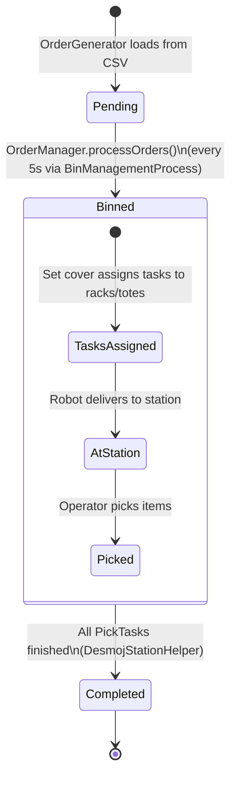
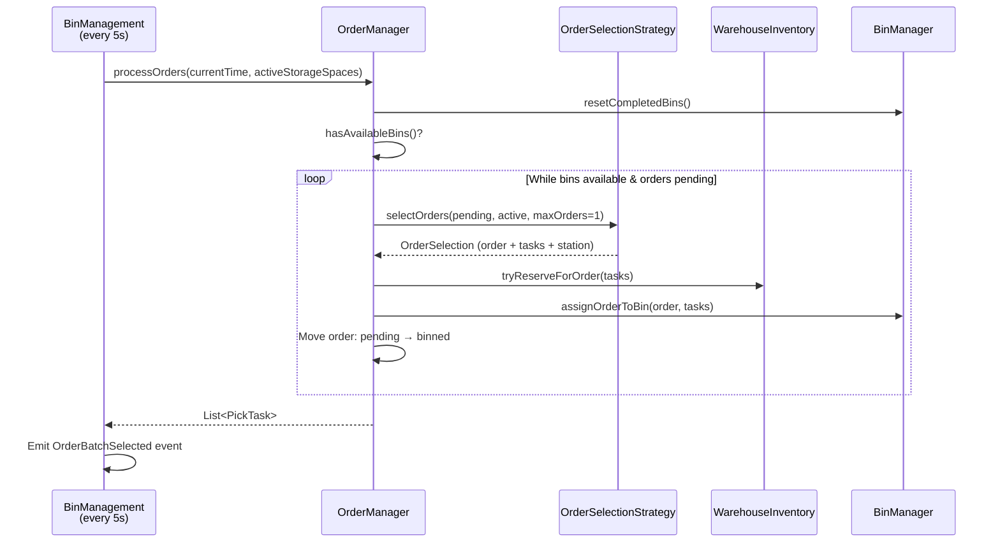
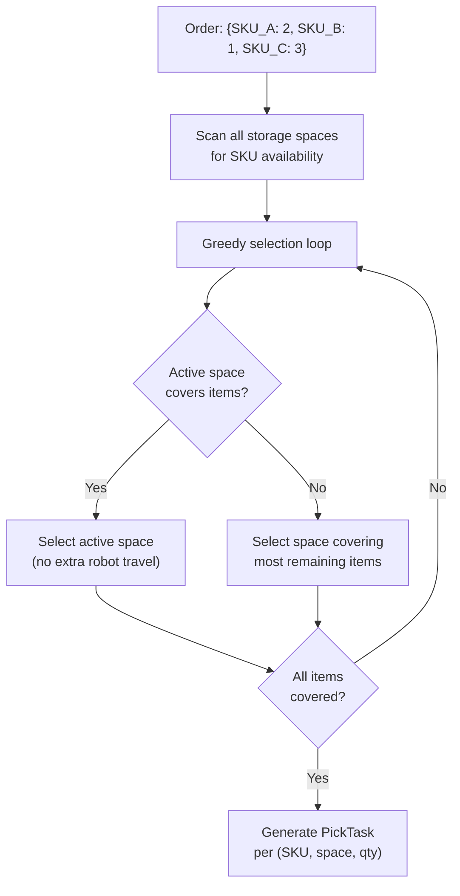
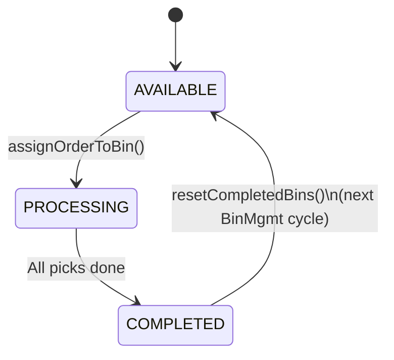
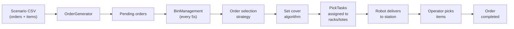

# Fleet Simulator — Order & Operator System

How orders are generated, selected, assigned to bins, picked by operators, and completed.

## Order Lifecycle



## The 5-Second Loop

`DesmojBinManagementProcess` runs continuously, checking every 5 seconds:



**Active storage spaces** — racks/totes currently in transit or at stations. Orders that use these get "piggybacked" — no additional robot travel needed.

## Order Selection Algorithms

Three pluggable strategies, configured via `algorithmConfig.orderSelectionAlgorithm`:

### 1. MAXIMIZE_PPF_DIRECTLY

**Objective:** Maximize Picks Per Face (PPF).

```
PPF = totalPicks / uniqueStorageSpaces
```

**How:** Greedy — iteratively selects order with highest marginal PPF. Orders using only already-selected storage spaces get infinite priority.

**Best for:** Maximizing operator utilization when travel cost is secondary.

### 2. MAXIMIZE_PPF_WITH_TIERING

**Objective:** Balance storage space reuse vs new openings.

**Scoring:**
| Factor | Score |
|--------|-------|
| Active reuse (at station/relay) | +100 per space |
| Batch reuse (opened this round) | +100 per space |
| New storage space | -1000 per space |
| Base | +totalPickQuantity |

**Best for:** Reducing robot cycles by aggressively reusing active storage spaces.

### 3. MAXIMIZE_TPQ_WITH_VUT

**Objective:** Optimize Task Pool Quality (TPQ) to balance travel and operator time.

```
TPQ = (totalTravelTime + totalOperatorTime) / totalOperatorTime
```

**Multi-objective scoring:**
- Minimizes deviation from target TPQ (precomputed from warehouse geometry)
- Rack reuse bonus: +10 per reused rack
- Rack overload penalty: -20 per pick exceeding 7-pick threshold per storage space
- Station bounds check: soft penalty for TPQ deviation

**Best for:** Balanced throughput when both travel and operator time matter.

## Set Cover Algorithm

All strategies share this core: given an order's items, find the minimum set of storage spaces that covers all items.



**Piggybacking:** Active storage spaces (already at station/relay) are preferred — they require zero additional robot travel, dramatically improving throughput.

## Zone Load Balancing (RELAY only)

Strategies group candidate orders by zone load before scoring:

```
Zone load = count of pending tasks assigned to totes in that zone
```

Orders in **lowest-load zones** are selected first (TreeMap ordering), preventing any single zone from becoming a bottleneck. Controlled by `algorithmConfig.relayZoneLoadBalancingEnabled()`.

## Bin Management

Each station has N bins (from `operatorConfig.numBins`). An operator works one bin at a time.



| Bin State | Meaning |
|-----------|---------|
| AVAILABLE | Empty, waiting for order assignment |
| PROCESSING | Operator is picking items |
| COMPLETED | All items picked, awaiting reset |

**Capacity gate:** `OrderManager.processOrders()` only assigns orders while `BinManager.canAssignMoreOrders() == true` (at least one AVAILABLE bin exists).

## PickTask

The atomic unit of work — one SKU pick from one storage space:

| Field | Description |
|-------|-------------|
| `taskId` | Unique identifier |
| `orderId` | Parent order |
| `item` | SKU details |
| `quantity` | How many to pick |
| `storageSpaceId` | RackId or ToteId |
| `stationId` | Assigned station |
| `createdTime` | Simulation time |

**Lifecycle:** Created during set cover → assigned to bin → robot delivers storage space to station → operator picks → `TaskCompleted` event → check if order complete.

## TPQ Calculator

Pre-calculates target TPQ from warehouse geometry:

```
avgTravelDistance = f(warehouse dimensions, station positions)
avgTravelTime = (avgTravelDistance / robotSpeed) × navFactor × pathfindingFactor
avgOperatorTime = operatorTimePerPick × targetPicksPerFace
targetTPQ = (avgTravelTime + avgOperatorTime) / avgOperatorTime
```

Used by `MAXIMIZE_TPQ_WITH_VUT` strategy as the optimization target. Runtime TPQ is measured and compared against this target.

## End-to-End Flow



## Key Files

| Class | Path (relative to `fleet-simulator/src/main/java/.../`) |
|-------|------|
| `OrderManager` | `domain/order/OrderManager.java` |
| `OrderGenerator` | `domain/order/OrderGenerator.java` |
| `Order` | `domain/order/Order.java` |
| `PickTask` | `domain/robot/PickTask.java` |
| `OrderSelectionStrategy` | `domain/order/strategies/OrderSelectionStrategy.java` |
| `AbstractOrderSelectionStrategy` | `domain/order/strategies/AbstractOrderSelectionStrategy.java` |
| `MaximizePpfDirectlyStrategy` | `domain/order/strategies/MaximizePpfDirectlyStrategy.java` |
| `MaximizePpfWithTieringStrategy` | `domain/order/strategies/MaximizePpfWithTieringStrategy.java` |
| `MaximizeTPQStrategy` | `domain/order/strategies/MaximizeTPQStrategy.java` |
| `BinManager` | `domain/station/BinManager.java` |
| `TpqCalculator` | `simulator/metrics/TpqCalculator.java` |
| `DesmojBinManagementProcess` | `simulator/orchestrator/DesmojBinManagementProcess.java` |
| `DesmojStationHelper` | `simulator/orchestrator/helper/DesmojStationHelper.java` |
