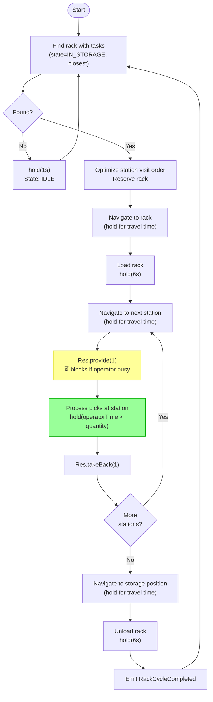
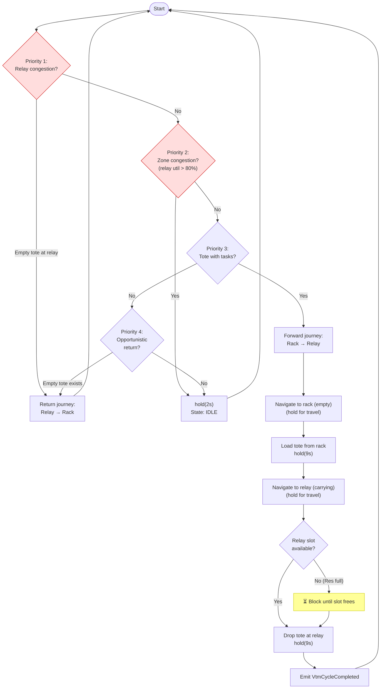
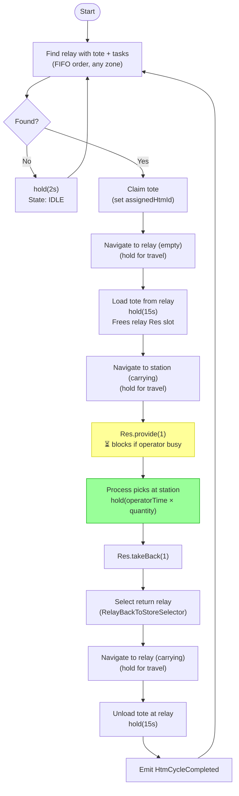
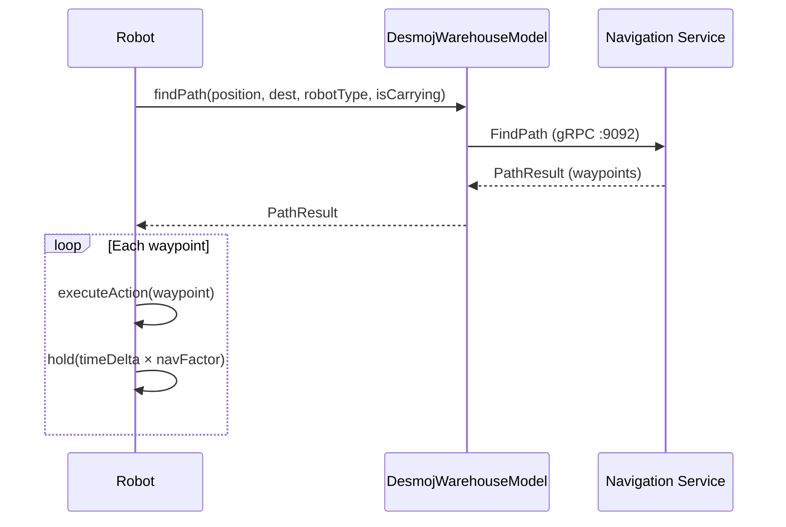
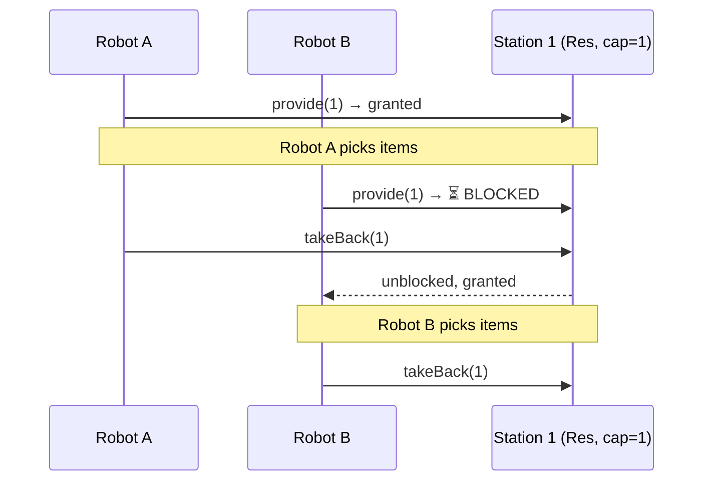

# Fleet Simulator — Robot Processes

Each robot is a Desmo-J `SimProcess` with its own lifecycle loop. Three robot types serve two warehouse system types.

## Robot Types

| Type | System | Moves | Zone-bound | Operator interaction |
|------|--------|-------|------------|---------------------|
| **RTP** | RTP | Entire racks: storage → station → storage | No | Yes (blocks for operator) |
| **VTM** | RELAY | Single totes: rack → relay position | Yes (assigned zones) | No |
| **HTM** | RELAY | Single totes: relay → station → relay | No | Yes (blocks for operator) |

## RTP Robot Lifecycle

`DesmojRtpRobotProcess` — transports racks from storage to picking stations and back.

**Constants:** `LOADING_TIME = 6s`, `UNLOADING_TIME = 6s`, `IDLE_CHECK = 1s`

**Multi-station optimization:** Nearest-neighbor heuristic orders station visits to minimize total travel.

## VTM Lifecycle

`DesmojVtmProcess` — vertical tote mover, zone-bound. Priority-based decision making prevents relay congestion.

**Constants:** `LOADING_TIME = 9s`, `UNLOADING_TIME = 9s`, `IDLE_CHECK = 2s`, `HIGH_RELAY_UTIL = 80%`

**Zone-bound:** Each VTM only services racks/relays in its assigned zones. Prevents cross-zone traffic.

**Congestion management:** Priority system ensures return journeys (clearing relay) always happen before forward journeys (adding to relay).

## HTM Lifecycle

`DesmojHtmProcess` — horizontal tote mover, global operation. Delivers totes from relays to stations.

**Constants:** `LOADING_TIME = 15s`, `UNLOADING_TIME = 15s`, `IDLE_CHECK = 2s`

**Currently single-station per cycle.** Multi-station planned for future.

## Navigation Integration

All robots share the same pathfinding interface via `DesmojWarehouseModel.findPath()`:

**Obstacle avoidance modes:**
- `isCarrying = false` — empty robot, can use narrow paths through racks
- `isCarrying = true` — loaded robot, needs wider clearance

**navFactor** — configurable multiplier on travel time (default 1.0, increase to model congestion).

## Operator Resource Queueing

Operators are modeled as Desmo-J `Res` resources with capacity=1 per station:

Only RTP and HTM robots interact with operators. VTMs drop totes at relays (no operator needed).

## Task Processing at Station

`DesmojStationHelper.processStorageSpaceTasks()` — called while operator resource is held:

1. For each task at this station on the rack/tote:
   - Remove task from storage space
   - Consume inventory
   - Emit `TaskCompleted` event
   - Check if order is fully completed
2. **Batched time advancement** — single `hold(totalOperatorTime)` at end
   - More efficient than per-task holds
   - `totalOperatorTime = operatorTimePerPick × totalQuantity`

## Cycle Metrics

### RTP Cycle (`RackCycleCompleted`)

| Metric | Description |
|--------|-------------|
| travelTime | Total navigation time (outbound + return) |
| processingTime | Total operator time at stations |
| totalPicks | Items picked across all stations |
| stationsVisited | List of station IDs |
| isMultiStation | Whether multiple stations visited |
| perStationPicks | Breakdown per station |

### VTM Cycle (`VtmCycleCompleted`)

| Metric | Description |
|--------|-------------|
| totalTravelTime | Navigation time (to rack + to relay) |
| toteId | Tote transported |
| rackId | Source rack |
| relayId | Destination relay |

### HTM Cycle (`HtmCycleCompleted`)

| Metric | Description |
|--------|-------------|
| totalTravelTime | Navigation time (relay → station → relay) |
| processingTime | Total operator time |
| totalPicks | Items picked |
| stationsVisited | List of station IDs |
| perStationPicks | Breakdown per station |

## Comparison Table

| Aspect | RTP | VTM | HTM |
|--------|-----|-----|-----|
| Cargo | Entire rack | Single tote | Single tote |
| Pickup from | Storage position | Rack in zone | Relay position |
| Deliver to | Station(s) | Relay position | Station(s) |
| Zone-bound | No | Yes | No |
| Operator queue | Yes | No | Yes |
| Multi-station | Yes (optimized) | No | No (planned) |
| Loading time | 6s | 9s | 15s |
| Unloading time | 6s | 9s | 15s |
| Idle check | 1s | 2s | 2s |
| Blocking on | Operator `Res` | Relay `Res` capacity | Operator `Res` |

## Key Files

| Class | Path (relative to `fleet-simulator/src/main/java/.../`) |
|-------|------|
| `DesmojRtpRobotProcess` | `simulator/orchestrator/DesmojRtpRobotProcess.java` |
| `DesmojVtmProcess` | `simulator/orchestrator/DesmojVtmProcess.java` |
| `DesmojHtmProcess` | `simulator/orchestrator/DesmojHtmProcess.java` |
| `DesmojStationHelper` | `simulator/orchestrator/helper/DesmojStationHelper.java` |
| `DesmojBinManagementProcess` | `simulator/orchestrator/DesmojBinManagementProcess.java` |
| `DesmojMetricMonitoringProcess` | `simulator/orchestrator/DesmojMetricMonitoringProcess.java` |
| `DesmojSnapshotCaptureProcess` | `simulator/snapshot/DesmojSnapshotCaptureProcess.java` |
| `Robot` | `domain/robot/Robot.java` |
