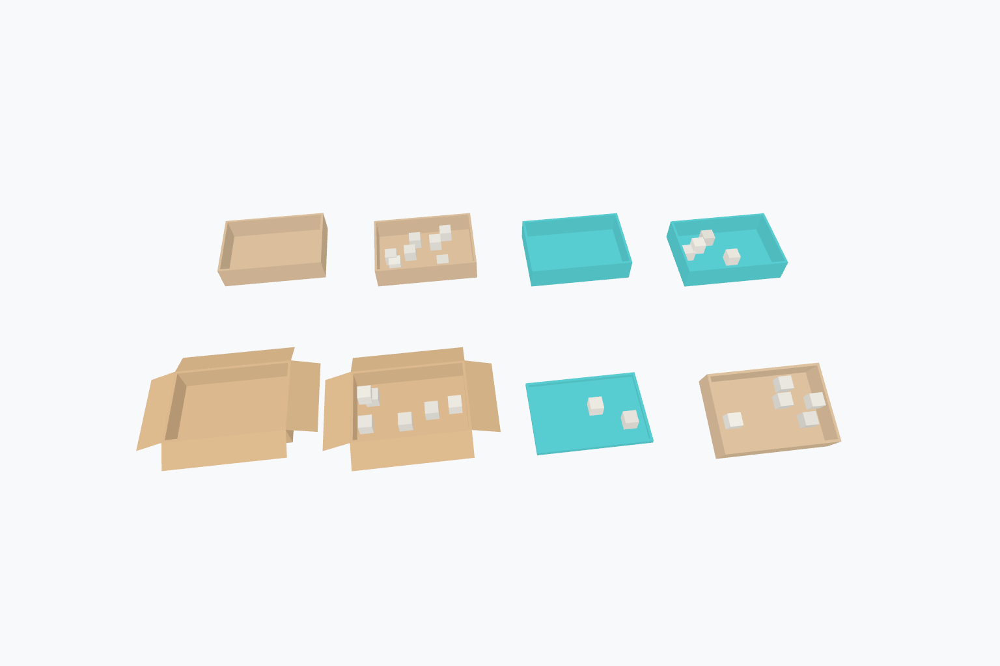

# Container and conveyor rendering — September 8

The [dispatch/opacity follow-up](outbound-dispatch-2026-09-08.md) fixes an
interaction missed by the first container-only preview: robot silhouettes were
being drawn through opaque container surfaces by the rack see-through pass.
The corrected draw order passes a real-GPU check with both robots and containers.

Inventory and order totes are open, opaque shells. Cartons have four flaps folded
outward and down; reusable trays retain their shallow profile. Each recorded
physical contents unit contributes one cube inside its container. Offsets remain
inside the walls, may overlap, and are stable when the cursor moves backward.
Containers and their contents share their robot's rotation, or the conveyor's
local heading and inclination. The same renderer handles racks, relays, HTMs,
VTMs and conveyor custody. Cartons remain on order HTMs during EasyLoop picking;
these graphics do not put cartons onto the inventory conveyor.

The back row shows inventory totes and order totes; the front shows cartons,
a tray and an inclined tote. This image comes from the production GPU pipeline,
not a separate drawing implementation. The ignored `render_open_container_preview`
test writes it only when `CONTAINER_PREVIEW_PNG` supplies an explicit path.

The main EasyLoop deck is now 647.5 mm above the floor, and the bottom of its
presentation chutes is 575 mm. These are provisional visual dimensions from
Daniel's scale correction, not surveyed elevations. Dropoff and collection ends
are flat: their stepped ramps were removed. Container bases use the same deck
and chute geometry, rather than an unrelated handoff-height constant.

The old fixed occupancy gauge discarded tote identities. Playback now retains
each tote and interpolates it along the drawn conveyor during recorded inbound
and return intervals. Between those intervals it remains at the presentation
chute. Recorded contents mutations show the units leaving the inventory tote
and arriving in its paired order container. Live and saved-profile playback use
the same equipment geometry and timed records. Older profiles without quantity
or transit records keep their known container metadata and stationary landmarks;
no contents or journey times are invented.

The travel intervals use existing task milestones: boarding to presentation
readiness, then pick completion to collection readiness. They do not implement
motor acceleration, shared belt start/stop controls, physical tote spacing, or a
detailed lateral-transfer mechanism. Inbound waiting can therefore appear as
slower travel. No task service time or custody rule was shortened for animation.

## Validation

- 104 renderer/application unit tests and both WGSL validation tests pass.
- 110 observer tests pass, with one pre-existing ignored test.
- The production GPU preview passes and was visually inspected.
- Twelve fulfillment orchestration checks, including a collision-enabled check
  against physical pick/collection timestamps, and three handoff-render checks
  pass. The older handoff checks were updated to recognize the current
  `OnConveyance` custody state as well as the legacy `OnConveyor` state.
- Headed **iteration 02** completes the 500-source-order cohort with 576 picks,
  500 extractions and 2,292 VTM cycles in **5,350.287 simulation seconds** —
  exactly the preceding physical baseline. Its 1,152 transit records are two
  travel intervals per inventory visit. The XLSX was written successfully.

The broad desvis test run also encountered a Cencora putaway scheduler stall in
`no_bot_cell_collisions_minimal_putaway_orders_0`, after 60 putaways and before
its renderer collision assertions. This is a failed check, not a passing
collision test. Other known Cencora/legacy inbound stalls remain documented in
[the floor-validation record](floor-alignment-2026-09-08.md).
