# Relay System Metrics Hierarchy - Visual Formats

This document contains visual representations of the metrics hierarchy for use in different tools.

---

## Section 1: Mermaid Flowchart

Copy the content between the triple backticks into a `.mmd` file or any Mermaid-compatible viewer.

```mermaid
flowchart TD
    %% ============================================================
    %% LEGEND
    %% ============================================================
    subgraph Legend["Legend: Relationship Types"]
        direction LR
        LEG1["Metric A"] ==>|"FORMULA"| LEG2["Metric B"]
        LEG3["Metric C"] -->|"CAUSAL"| LEG4["Metric D"]
        LEG5["Metric E"] -.->|"CONTROL"| LEG6["Metric F"]
    end

    %% ============================================================
    %% LEVEL 0: ROOT
    %% ============================================================
    UPH["🎯 UPH\n(Units Per Hour)\n───────────\nSystem | Per-PPS"]

    %% ============================================================
    %% LEVEL 1: PRIMARY SPLIT
    %% ============================================================
    subgraph Level1["Level 1: Primary Decomposition"]
        PPT["Picks/Tote\n───────────\nDEMAND"]
        TPH["Tote Presentations/Hr\n───────────\nSUPPLY"]
    end

    UPH ==>|"UPH = PPT × TPH"| PPT
    UPH ==>|"UPH = PPT × TPH"| TPH

    %% ============================================================
    %% DEMAND SIDE
    %% ============================================================
    subgraph Demand["Demand Side (Picks/Tote)"]
        OLT["Orderlines/Tote\n───────────\nPer-PPS"]
        QPL["Qty/Orderline\n───────────\nEXTERNAL"]
        SKU_AFF["SKU Affinity\n───────────\nEXTERNAL"]
        TOTE_SEL["Tote Selection\nStrategy\n───────────\nPICK"]
    end

    PPT ==>|"= OLT × QPL"| OLT
    PPT ==>|"= OLT × QPL"| QPL
    SKU_AFF -->|"enables batching"| OLT
    TOTE_SEL -.->|"PPF vs TOR-aware"| OLT

    %% ============================================================
    %% SUPPLY SIDE: TWO-LOOP ARCHITECTURE
    %% ============================================================
    subgraph Supply["Supply Side: Two-Loop Architecture"]

        %% VTM LOOP
        subgraph VTM_Loop["VTM Loop (Per-VA, Per-PPS)"]
            TPH_VTM["TPH_vtm\n───────────\n= Neff × 60 / Tcycle"]
            NEFF_VTM["N_eff_vtm\n───────────\nEffective VTMs"]
            T_VTM["VTM Cycle Time\n───────────\nPer-VA, Per-PPS"]
        end

        %% RELAY BUFFER
        subgraph Relay["Relay Buffer (Per-VA)"]
            OCC["Occupancy %\n───────────\nMVTS monitors"]
            DWELL["Dwell Time\n───────────\nCoordination quality"]
            FLOW_BAL["Flow Balance\n───────────\n(arrival-departure)/departure"]
            L_BLOCK["Blocking Loss\n───────────\nOcc > 80%"]
            L_IDLE["Idle Loss\n───────────\nOcc < 20%"]
        end

        %% HTM LOOP
        subgraph HTM_Loop["HTM Loop (Per-PPS)"]
            TPH_HTM["TPH_htm\n───────────\n= Neff × 60 / Tcycle"]
            NEFF_HTM["N_eff_htm\n───────────\nEffective HTMs"]
            T_HTM["HTM Cycle Time\n───────────\nPer-PPS"]
        end
    end

    TPH ==>|"min(loops) × (1-losses)"| TPH_VTM
    TPH ==>|"min(loops) × (1-losses)"| TPH_HTM
    L_BLOCK -->|"reduces TPH"| TPH
    L_IDLE -->|"reduces TPH"| TPH

    TPH_VTM ==>|"throughput"| NEFF_VTM
    TPH_VTM ==>|"throughput"| T_VTM
    TPH_HTM ==>|"throughput"| NEFF_HTM
    TPH_HTM ==>|"throughput"| T_HTM

    %% Relay Buffer Dynamics
    OCC -->|"high"| L_BLOCK
    OCC -->|"low"| L_IDLE
    FLOW_BAL -->|"predicts"| OCC
    TPH_VTM -->|"arrival"| FLOW_BAL
    TPH_HTM -->|"departure"| FLOW_BAL

    %% ============================================================
    %% VTM CYCLE TIME BREAKDOWN
    %% ============================================================
    subgraph VTM_Cycle["VTM Cycle Time Components"]
        FETCH["Fetch Time\n───────────\nPHYSICAL"]
        TRAVEL_V["Travel Time\n───────────\nPICK + MVTS"]
        HANDOFF_V["Handoff Time\n───────────\nPHYSICAL"]
        WAIT_V["Wait Time\n───────────\nMVTS + NAV"]
    end

    T_VTM ==>|"= sum of"| FETCH
    T_VTM ==>|"= sum of"| TRAVEL_V
    T_VTM ==>|"= sum of"| HANDOFF_V
    T_VTM ==>|"= sum of"| WAIT_V

    subgraph VTM_Detail["VTM Detail"]
        VERT_MOVE["Vertical Move\n───────────\nPHYSICAL"]
        EXTRACT["Extract Time\n───────────\nPHYSICAL"]
        RACK_LOC["Rack Location\n───────────\nPICK selects"]
        RELAY_POS["Relay Position\n───────────\nMVTS assigns"]
        WAIT_FULL["Wait: Relay Full\n───────────\nMVTS"]
        WAIT_TRAF["Wait: Traffic\n───────────\nNAV"]
    end

    FETCH ==>|"= vert + extract"| VERT_MOVE
    FETCH ==>|"= vert + extract"| EXTRACT
    RACK_LOC -->|"distance"| TRAVEL_V
    RELAY_POS -->|"distance"| TRAVEL_V
    OCC -->|"when > 80%"| WAIT_FULL
    WAIT_FULL -->|"blocked"| WAIT_V
    WAIT_TRAF -->|"congestion"| WAIT_V

    %% ============================================================
    %% HTM CYCLE TIME BREAKDOWN
    %% ============================================================
    subgraph HTM_Cycle["HTM Cycle Time Components"]
        PICKUP["Pickup Time\n───────────\nPHYSICAL"]
        TRAVEL_H["Travel Time\n───────────\nMVTS"]
        STATION["Station Time\n───────────\nMVTS + PICK"]
        RETURN["Return Time\n───────────\nMVTS"]
    end

    T_HTM ==>|"= sum of"| PICKUP
    T_HTM ==>|"= sum of"| TRAVEL_H
    T_HTM ==>|"= sum of"| STATION
    T_HTM ==>|"= sum of"| RETURN

    subgraph HTM_Detail["HTM Detail"]
        R2S["Relay→Station\n───────────\nMVTS assigns"]
        S2S["Station→Station\n───────────\nMVTS routing"]
        N_STOPS["# of Stops\n───────────\nMVTS decision"]
        QUEUE["Queue Time\n───────────\nMVTS balance"]
        PICK_T["Pick Time\n───────────\nPHYS + PICK"]
        OP_SPEED["Operator Speed\n───────────\nPHYSICAL"]
    end

    R2S -->|"distance"| TRAVEL_H
    S2S -->|"multi-stop"| TRAVEL_H
    N_STOPS -.->|"routing"| S2S
    STATION ==>|"= queue + pick"| QUEUE
    STATION ==>|"= queue + pick"| PICK_T
    OP_SPEED -->|"rate"| PICK_T
    PPT -->|"picks needed"| PICK_T

    %% ============================================================
    %% EFFECTIVE ROBOTS
    %% ============================================================
    subgraph Robots["Effective Robot Calculation"]
        N_DEPLOY["N_deployed\n───────────\nPHYSICAL"]
        AVAIL["Availability\n───────────\nPHYSICAL"]
        UTIL["Utilization\n───────────\nPICK + MVTS"]
        UPTIME["Uptime Rate\n───────────\nPHYSICAL"]
        ERR_RATE["Error Rate\n───────────\nPHYSICAL"]
        TASK_AV["Task Availability\n───────────\nPICK + MVTS"]
        TRAFFIC["Traffic Blocking\n───────────\nNAV"]
    end

    NEFF_VTM ==>|"= N × A × U"| N_DEPLOY
    NEFF_VTM ==>|"= N × A × U"| AVAIL
    NEFF_VTM ==>|"= N × A × U"| UTIL
    NEFF_HTM ==>|"= N × A × U"| N_DEPLOY
    NEFF_HTM ==>|"= N × A × U"| AVAIL
    NEFF_HTM ==>|"= N × A × U"| UTIL

    AVAIL ==>|"= uptime × (1-err)"| UPTIME
    AVAIL ==>|"= uptime × (1-err)"| ERR_RATE
    TASK_AV -->|"tasks to do"| UTIL
    TRAFFIC -->|"blocked"| UTIL

    %% ============================================================
    %% TOR CONTROL LOOP
    %% ============================================================
    subgraph TOR["TOR Control Loop (PICK)"]
        TOR_SYS["TOR_system\n───────────\nPICK output"]
        TOR_PPS["TOR_pps\n───────────\nPer-PPS"]
        TOR_TGT["TOR Target\n───────────\n= Bots/Operators"]
        TOR_DEV["TOR Deviation\n───────────\nactual - target"]
    end

    TRAVEL_V -->|"contributes"| TOR_SYS
    TRAVEL_H -->|"contributes"| TOR_SYS
    TOR_SYS -.->|"controls"| TOTE_SEL
    TOR_DEV -->|"triggers switch"| TOTE_SEL
    TOR_SYS ==>|"deviation"| TOR_TGT
    TOR_SYS ==>|"deviation"| TOR_DEV

    %% ============================================================
    %% TASK DISTRIBUTION
    %% ============================================================
    subgraph TaskDist["Task Distribution (PICK)"]
        VA_LOAD["VA Load Balance\n───────────\nPICK"]
        PPS_LOAD["PPS Load Balance\n───────────\nPICK"]
        VA_VAR["VA Load Variance\n───────────\nPICK"]
        PPS_VAR["PPS Load Variance\n───────────\nPICK"]
        STARVE["PPS Starvation\n───────────\nPICK + MVTS"]
    end

    VA_LOAD ==>|"variance"| VA_VAR
    PPS_LOAD ==>|"variance"| PPS_VAR
    VA_LOAD -->|"affects"| T_VTM
    PPS_LOAD -->|"affects"| QUEUE
    PPS_VAR -->|"imbalance"| STARVE
    STARVE -->|"idle ops"| L_IDLE

    %% ============================================================
    %% STYLING
    %% ============================================================
    classDef root fill:#1a237e,stroke:#000,stroke-width:3px,color:#fff
    classDef level1 fill:#0d47a1,stroke:#000,stroke-width:2px,color:#fff
    classDef physical fill:#7b1fa2,stroke:#000,color:#fff
    classDef pick fill:#1565c0,stroke:#000,color:#fff
    classDef mvts fill:#c62828,stroke:#000,color:#fff
    classDef nav fill:#2e7d32,stroke:#000,color:#fff
    classDef external fill:#546e7a,stroke:#000,color:#fff
    classDef relay fill:#ef6c00,stroke:#000,color:#fff

    class UPH root
    class PPT,TPH level1
    class VERT_MOVE,EXTRACT,HANDOFF_V,PICKUP,RETURN,OP_SPEED,UPTIME,ERR_RATE,N_DEPLOY physical
    class OLT,TOTE_SEL,RACK_LOC,TOR_SYS,TOR_PPS,TOR_TGT,TOR_DEV,VA_LOAD,PPS_LOAD,VA_VAR,PPS_VAR,PICK_T pick
    class RELAY_POS,WAIT_FULL,R2S,S2S,N_STOPS,QUEUE,TASK_AV,STARVE,OCC,DWELL,FLOW_BAL,L_BLOCK,L_IDLE mvts
    class WAIT_TRAF,TRAFFIC nav
    class SKU_AFF,QPL external
```

---

## Section 2: XMind-Compatible Markdown

Copy everything below this line into a new `.md` file and import into XMind.

---

# Relay System Metrics Hierarchy

## UPH (Units Per Hour)
- **Type**: Root KPI
- **Scope**: System + Per-PPS
- **Formula**: UPH = Picks/Tote × Tote_Presentations/Hour

### Picks/Tote (DEMAND)
- **Type**: Demand-side driver
- **Scope**: Per-PPS
- **Formula**: Picks/Tote = Orderlines/Tote × Qty/Orderline

#### Orderlines/Tote
- **Type**: Causal metric
- **Scope**: Per-PPS
- **Layer**: PICK
- **Influences**:
    - SKU Affinity in Orders (EXTERNAL) → enables batching
    - Tote Selection Strategy (PICK) → PPF-first vs TOR-aware

##### SKU Affinity
- **Type**: External input
- **Layer**: EXTERNAL (Customer orders)
- **Impact**: Higher affinity → more orderlines per tote

##### Tote Selection Strategy
- **Type**: Control variable
- **Layer**: PICK
- **Options**:
    - PPF-First: Maximize picks per fetch
    - TOR-Aware: Balance distance vs picks
- **Controlled by**: TOR Deviation

#### Qty/Orderline
- **Type**: External input
- **Layer**: EXTERNAL (Customer orders)

### Tote Presentations/Hour (SUPPLY)
- **Type**: Supply-side driver
- **Scope**: System + Per-PPS
- **Formula**: TPH = min(TPH_vtm, TPH_htm, TPH_station) × (1 - L_block) × (1 - L_idle)

#### VTM Loop Throughput (TPH_vtm)
- **Type**: Formula metric
- **Scope**: Per-VA, Per-PPS
- **Formula**: TPH_vtm = N_eff_vtm × 60 / T_vtm_cycle

##### N_eff_vtm (Effective VTMs)
- **Type**: Formula metric
- **Scope**: Per-VA
- **Formula**: N_eff = N_deployed × Availability × Utilization

###### N_deployed (VTM)
- **Type**: Physical constant
- **Layer**: PHYSICAL

###### Availability
- **Type**: Formula metric
- **Layer**: PHYSICAL
- **Formula**: Availability = Uptime_Rate × (1 - Error_Rate)

####### Uptime Rate
- **Type**: Physical metric
- **Layer**: PHYSICAL

####### Error Rate
- **Type**: Physical metric
- **Layer**: PHYSICAL

###### Utilization
- **Type**: Causal metric
- **Layer**: PICK + MVTS
- **Influences**:
    - Task Availability (PICK + MVTS) → tasks to execute
    - Traffic Blocking (NAV) → time lost to congestion

##### VTM Cycle Time (T_vtm)
- **Type**: Formula metric
- **Scope**: Per-VA, Per-PPS
- **Formula**: T_vtm = Fetch + Travel + Handoff + Wait

###### Fetch Time
- **Type**: Formula metric
- **Layer**: PHYSICAL
- **Formula**: Fetch = Vertical_Move + Extract_Time

####### Vertical Move
- **Type**: Physical constant
- **Layer**: PHYSICAL
- **Depends on**: Rack height, VTM vertical speed

####### Extract Time
- **Type**: Physical constant
- **Layer**: PHYSICAL

###### Travel Time (VTM)
- **Type**: Causal metric
- **Layer**: PICK + MVTS
- **Influences**:
    - Rack Location (PICK) → horizontal distance
    - Relay Position (MVTS) → target position

####### Rack Location
- **Type**: Control output
- **Layer**: PICK
- **Impact**: Farther rack → longer travel → higher TOR

####### Relay Position
- **Type**: Control output
- **Layer**: MVTS

###### Handoff Time
- **Type**: Physical constant
- **Layer**: PHYSICAL

###### Wait Time (VTM)
- **Type**: Causal metric
- **Layer**: MVTS + NAV
- **Components**:
    - Wait: Relay Full (MVTS) → when occupancy > 80%
    - Wait: Traffic (NAV) → aisle congestion

####### Wait: Relay Full
- **Type**: Causal metric
- **Layer**: MVTS
- **Triggered by**: Relay Occupancy > 80%

####### Wait: Traffic
- **Type**: Causal metric
- **Layer**: NAV

#### Relay Buffer (Coupling Point)
- **Type**: State metrics
- **Scope**: Per-VA
- **Layer**: MVTS

##### Occupancy %
- **Type**: State metric
- **Formula**: Occupancy = Totes_in_buffer / N_relay × 100
- **Healthy range**: 20% - 80%
- **Zones**:
    - < 20%: Starvation zone (HTMs idle)
    - 20-80%: Healthy operating zone
    - > 80%: Blocking zone (VTMs wait)

##### Dwell Time
- **Type**: Latency metric
- **Definition**: Avg seconds tote waits at relay
- **Indicates**: Coordination quality between loops

##### Flow Balance
- **Type**: Rate metric
- **Formula**: (VTM_arrival - HTM_departure) / HTM_departure
- **Interpretation**:
    - > 0: Buffer filling, risk of blocking
    - ≈ 0: Steady state
    - < 0: Buffer draining, risk of starvation

##### Blocking Losses (L_block)
- **Type**: Loss metric
- **Layer**: MVTS
- **Triggered by**: Occupancy > 80%
- **Impact**: Reduces TPH

##### Idle Losses (L_idle)
- **Type**: Loss metric
- **Layer**: MVTS
- **Triggered by**: Occupancy < 20%
- **Impact**: Reduces TPH, operators wait

#### HTM Loop Throughput (TPH_htm)
- **Type**: Formula metric
- **Scope**: Per-PPS
- **Formula**: TPH_htm = N_eff_htm × 60 / T_htm_cycle

##### N_eff_htm (Effective HTMs)
- **Type**: Formula metric
- **Scope**: System
- **Formula**: N_eff = N_deployed × Availability × Utilization

###### N_deployed (HTM)
- **Type**: Physical constant
- **Layer**: PHYSICAL

##### HTM Cycle Time (T_htm)
- **Type**: Formula metric
- **Scope**: Per-PPS
- **Formula**: T_htm = Pickup + Travel + Station_Time + Return

###### Pickup Time
- **Type**: Physical constant
- **Layer**: PHYSICAL

###### Travel Time (HTM)
- **Type**: Causal metric
- **Layer**: MVTS
- **Formula**: Travel = Relay→Station + (N_stops-1) × Station→Station
- **Influences**:
    - Relay→Station distance (MVTS) → station assignment
    - Station→Station distance (MVTS) → multi-stop routing
    - # of Stops (MVTS) → routing decision

####### Relay→Station Distance
- **Type**: Control output
- **Layer**: MVTS

####### Station→Station Distance
- **Type**: Causal metric
- **Layer**: MVTS
- **Depends on**: # of Stops

####### # of Stops
- **Type**: Control variable
- **Layer**: MVTS
- **Trade-off**:
    - Single stop: Lower cycle time, fewer picks/trip
    - Multi-stop: Higher cycle time, more picks/trip

###### Station Time
- **Type**: Formula metric
- **Layer**: MVTS + PICK
- **Formula**: Station_Time = Queue_Time + Pick_Time

####### Queue Time
- **Type**: Causal metric
- **Layer**: MVTS
- **Influenced by**: PPS Load Balance

####### Pick Time
- **Type**: Formula metric
- **Layer**: PHYSICAL + PICK
- **Formula**: Pick_Time = N_picks / Operator_Speed
- **Influences**:
    - Operator Speed (PHYSICAL)
    - Picks/Tote (PICK)

######## Operator Speed
- **Type**: Physical constant
- **Layer**: PHYSICAL

###### Return Time
- **Type**: Formula metric
- **Layer**: MVTS
- **Components**: Travel back + Handoff at relay

## TOR Control Loop
- **Type**: Control system
- **Layer**: PICK
- **Purpose**: Balance bot capacity with operator capacity

### TOR_system
- **Type**: Control output
- **Scope**: System-wide
- **Formula**: TOR = (Travel + Service) / Service
- **Interpretation**:
    - TOR = 1.0: Zero travel overhead (theoretical min)
    - TOR = 3.0: Travel is 2× productive work

### TOR_pps
- **Type**: Control output
- **Scope**: Per-PPS
- **Purpose**: Station-level TOR for local optimization

### TOR Target
- **Type**: Setpoint
- **Formula**: Target = Bots / Operators
- **Per loop**:
    - Target_TOR_vtm = V / O (VTMs / Operators)
    - Target_TOR_htm = H / O (HTMs / Operators)

### TOR Deviation
- **Type**: Error signal
- **Formula**: Deviation = TOR_actual - TOR_target
- **Control action**:
    - Deviation > 0: Bot-constrained → select closer totes
    - Deviation < 0: Operator-constrained → can afford farther totes

## Task Distribution Quality
- **Type**: Balance metrics
- **Layer**: PICK

### VA Load Balance
- **Type**: Distribution metric
- **Scope**: Across VAs
- **Impact**: Affects VTM congestion per aisle

#### VA Load Variance
- **Type**: Statistical metric
- **Healthy**: Low variance
- **High variance indicates**: Hotspots, uneven VTM load

### PPS Load Balance
- **Type**: Distribution metric
- **Scope**: Across PPSs
- **Impact**: Affects queue times

#### PPS Load Variance
- **Type**: Statistical metric
- **Healthy**: Low variance
- **High variance indicates**: Some operators overloaded, others idle

### PPS Starvation Count
- **Type**: Count metric
- **Layer**: PICK + MVTS
- **Definition**: # of PPS with 0 tasks when orders available
- **Healthy**: 0
- **Impact**: Operator idle time, reduces UPH

## Layer Responsibility Summary

### PICK (Order Processing)
- Picks/Tote, Orderlines/Tote
- TOR_system, TOR_pps (outputs)
- Rack Location selection
- VA Load Balance, PPS Load Balance
- Tote Selection Strategy

### MVTS (Task Scheduling + Relay)
- HTM Cycle Time components
- Relay Position assignment
- Station Assignment, Multi-stop Routing
- Relay Occupancy management
- Back-to-Store location selection
- Blocking/Idle loss management

### NAV (Navigation)
- Actual travel times
- Traffic conflicts
- Nav Factor (actual/theoretical)
- Wait: Traffic

### PHYSICAL (Hardware)
- Robot speeds (VTM, HTM)
- Fleet size
- Mechanism times (fetch, handoff, pickup)
- Operator speed
- Uptime, Error Rate

---

## Section 3: Relationship Legend

| Symbol | Relationship | Meaning | Example |
|--------|-------------|---------|---------|
| `═══` / `==>` | FORMULA | Exact mathematical: A = B × C | UPH = Picks/Tote × TPH |
| `───` / `-->` | CAUSAL | Directional influence | High TOR → Select closer totes |
| `- - -` / `-.->` | CONTROL | Control input/setpoint | TOR_target → Tote Selection |

---

## Section 4: Aggregation Levels

| Level | Scope | Metrics Available |
|-------|-------|-------------------|
| **System** | Entire warehouse | UPH, TOR_system, TPH, N_eff totals |
| **Per-PPS** | Single pick station | UPH_pps, TOR_pps, Cycle times, Queue time |
| **Per-VA** | Virtual Aisle | VTM metrics, Relay buffer, VA load |
| **Per-Robot** | Individual bot | Utilization, Cycle time, Wait time |
